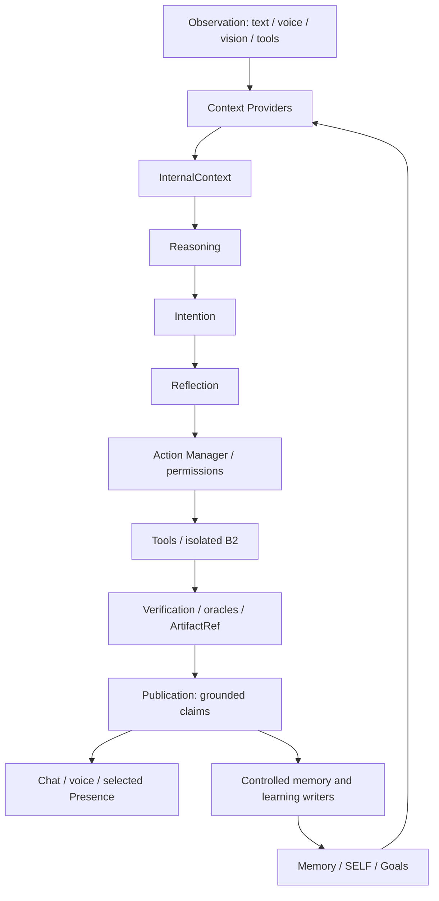

# Anydes

**Una IA que puede aprender a hacer lo que todavia no sabe hacer.**

Anydes is a persistent personal AI system designed to maintain context, reason,
use tools, verify actions and progressively extend its capabilities under
controlled security boundaries.

This repository is a **sanitized source/documentation release for Casa Abierta
evaluation**, not the complete model/runtime installation. It contains real
implementation code, not a replacement demo or mock architecture.

## Problem

Assistants built around isolated conversations often lose task continuity, have
limited access to useful tools, or report an action without independently checking
its result. Persistent context and extensibility also introduce privacy and
execution risks that need explicit boundaries.

## Solution

Anydes combines typed cognitive context, memory interfaces, SELF and goals,
contextual reasoning, a controlled action/tool system, artifact continuity,
verification and a publication boundary. Voice, vision and multiple visual
presences are adapters around the same core, not separate personalities or memories.

## Key Differentiator

**Anydes Forge: IN DEVELOPMENT / NEXT PHASE.**

An experimental controlled self-extension system designed to allow Anydes to
identify a missing capability, design/program it, test it in isolation, verify it
and make it available under authorization.

The current source includes code-generation and tool/verification infrastructure.
It does **not** implement a finished autonomous Forge registration pipeline.
See [ANYDES_FORGE.md](docs/ANYDES_FORGE.md).

## Architecture



[Architecture](docs/ARCHITECTURE.md) | [Security](docs/SECURITY.md) |
[Source map](docs/SOURCE_MAP.md) | [Current status](docs/CURRENT_STATUS.md)
| [Release tests](docs/TESTING.md)

## Current Capabilities

- Typed context and memory architecture; controlled memory/SELF writer interfaces.
- Interaction classification, PendingTask continuity and accumulated requirements.
- Tool/action permissions and default-deny filesystem boundaries.
- Windows B2 isolation, execution limits and independent verification/oracles.
- Source-code artifact creation, versions/references and grounded metadata queries.
- Publication checks that separate verified evidence from unsupported claims.
- Cloud reasoning with a bounded local fallback path.
- Professional Shell with hologram and existing avatar renderer interfaces.
- Local Presence state adapter and B4 speech-feature-driven animation.
- Parakeet STT, B4/Qwen TTS and vision integration source.

Memory **code/interfaces** are included, never the owner's memories. Some legacy
source files are empty in the audited tree; see [Portability](docs/PORTABILITY.md).
No claim is made that every imported legacy implementation is present here.

## Current Status

The author-accepted integrated system has a validated professional-shell manual
flow and **529 PASS, 0 FAIL** in its accepted regression run. B2 was independently
validated through real runtime, oracle and security tests. The final UI artifact
used BASIC verification: no artificial execution was added for a checklist.

Those are results from the configured author installation, **not a claim that all
529 tests have been rerun from this sanitized source distribution**. Release-copy
checks and limitations are reported in [audit/](audit/).

## Demo

At Casa Abierta, judges can observe the configured demonstration installation:
conversation/voice, the reactive hologram, task continuity, code/artifact creation,
the artifact's actual location and controlled verification. This source release
lets judges inspect the boundaries and corresponding tests without downloading
the full local model installation.

The independent [Presence Lab](experimentos/anydes_presence_lab_v001/) also exposes
the actual approved procedural orb and motion source. It is not a replacement core.

## Repository Limitations

No model weights, native runtime bundles, virtual environments, private profiles,
personal memories, recordings, screenshots, generated user artifacts or session
logs are included. This is not a full binary distribution or one-command setup.
Full voice/vision/avatar execution needs separately configured dependencies and
assets. Old installation-specific integrity/launch scripts are retained as source
where useful, not advertised as portable release entry points.

## Installation Overview

1. Clone this repository after its owner publishes it.
2. Create a virtual environment with Python 3.11-3.13.
3. Install `requirements.txt`; add AI/UI/voice/vision requirement groups as needed.
4. Create your own `.env` from `.env.example`; never commit credentials.
5. Obtain required models and native runtimes separately under their own licenses.
6. Configure their paths and your own profiles using [MODELS.md](docs/MODELS.md)
   and [PORTABILITY.md](docs/PORTABILITY.md).
7. Run `validate_release.bat` to check the published source release.

This validation script is **not the full Anydes launcher** for the approximately
70 GB installed environment. This evaluation package intentionally excludes model
weights and some runtime assets. Full runtime prerequisites are documented in
[PORTABILITY.md](docs/PORTABILITY.md) and [MODELS.md](docs/MODELS.md).

For source review without model downloads:

```text
python -B tools/check_source.py
python -B -m unittest discover -s tests -v
```

For the standalone visual laboratory (Node.js; no model inference):

```text
cd experimentos/anydes_presence_lab_v001
npm ci
npm start
```

Dependencies are installed by the reviewer, not bundled. The lab uses its existing
local server; it is not started automatically by any release audit.

## License

**No open-source license has yet been selected.** Publication for evaluation does
not automatically grant a software license. See [LICENSING_NOTE.md](docs/LICENSING_NOTE.md)
and [THIRD_PARTY_NOTICES.md](docs/THIRD_PARTY_NOTICES.md). Model redistribution
rights are not asserted by this repository.
