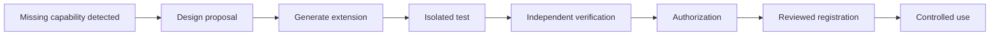

# Anydes Forge

**STATUS: IN DEVELOPMENT / NEXT MAJOR PHASE**

Forge is the intended controlled self-extension system, not a completed capability
in this release. The current project supplies reusable pieces such as generation,
typed capabilities, sandboxing, verification, artifacts and permissions.

Generated extensions may operate only in generated-extension directories and
authorized workspaces. They must never modify Core, SELF, protected memory,
security modules or the official launcher. Passing tests does not grant new
permissions or authorize registration automatically.

Future work includes capability-gap contracts, reviewable extension manifests,
revocation/versioning and explicit acceptance gates. No unrestricted self-modifying
agent, automatic promotion or completed Tool Builder is claimed.
